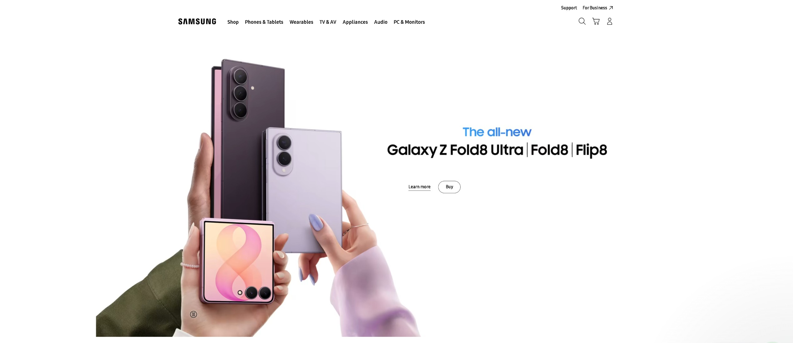

# 💎 JOON STORES Dub-Ind
### Apple × Samsung Dual Flagship E-Commerce Experience

 

### 🌐 [Visit Live Apple Store](https://antigravity-store-two.vercel.app) &nbsp;•&nbsp; 📱 [Visit Live Samsung Store](https://antigravity-store-two.vercel.app/samsung) &nbsp;•&nbsp; 📲 [Galaxy Z Fold8 Product Page](https://antigravity-store-two.vercel.app/samsung/galaxy-z-fold8)

 

---

## 🌟 Overview

**JOON STORES Dub-Ind** is an ultra-premium dual-brand digital commerce platform bringing factory-sealed Apple and Samsung flagship devices from Dubai directly to customers across India with worldwide official warranty and dedicated WhatsApp concierge support.

---

## 🚀 Live Experiences

| Brand Experience | URL | Highlights |
|---|---|---|
| **Apple iPhone 18 Pro** | [https://antigravity-store-two.vercel.app](https://antigravity-store-two.vercel.app) | Dark mode aesthetics, A20 Pro chip, Vapor Chamber, Interactive f/ aperture camera selector, Apple Intelligence. |
| **Samsung Galaxy Store** | [https://antigravity-store-two.vercel.app/samsung](https://antigravity-store-two.vercel.app/samsung) | Pure-white minimalist design, Google Flow cinematic hero video with autoplay & 5s hold replay, "Recommended for you" product carousel, Galaxy AI. |
| **Samsung Galaxy Z Fold8** | [https://antigravity-store-two.vercel.app/samsung/galaxy-z-fold8](https://antigravity-store-two.vercel.app/samsung/galaxy-z-fold8) | Official product page featuring lavender Fold8 artwork, blurred FOLD typography, Galaxy AI, Dynamic AMOLED 2X, and full technical specifications. |

---

## ✨ Flagship Highlights

### 🍏 Apple Store Experience
- **Interactive Pro Camera System:** State-driven variable aperture widget (`f/1.48` to `f/4.0`) that dynamically swaps imagery and specifications.
- **Vapor Chamber & A20 Pro Chip:** High-performance hardware presentation with custom alpha masks.
- **Apple Intelligence Shopping Assistant:** Siri-inspired interactive AI genius concierge with floating launcher.
- **Mixed-Ratio Product Carousel:** Tailored wide and narrow cards mirroring Apple's typography.

### 📱 Samsung Store Experience
- **Cinematic Hero Video:** Google Flow 9:16 rising foldable phones with automated 5-second final-frame freeze and replay cycle.
- **"Recommended for you" Carousel:** Single-track horizontal product slider with interactive progress indicator line, circular arrow controls, and 6 official device models (S26, S26 FE, S26+, S26 Ultra with S Pen, Z Fold8 Ultra, Tab S10 Lite).
- **Galaxy AI Concierge:** Samsung-themed AI assistant tailored with Galaxy ecosystem expertise.
- **One-Tap WhatsApp Concierge:** Instant pre-configured WhatsApp ordering with direct Dubai-to-India fulfillment.

---

## 🔒 Proprietary Codebase Notice

> [!IMPORTANT]
> The source code of this production website is proprietary and maintained in a private repository for commercial security. Live website access is publicly available via the links above.

---

## 📞 Direct Concierge & Support

- **Store:** JOON STORES Dub-Ind
- **WhatsApp Concierge:** [+91 91678 68179](https://wa.me/919167868179)
- **Email:** [juzer09jawadwala@gmail.com](mailto:juzer09jawadwala@gmail.com)
- **Warranty:** 100% Genuine Sealed Units • Worldwide Manufacturer Warranty

 

© 2026 JOON STORES Dub-Ind. All rights reserved. Apple, iPhone, Samsung, and Galaxy are trademarks of their respective owners.

